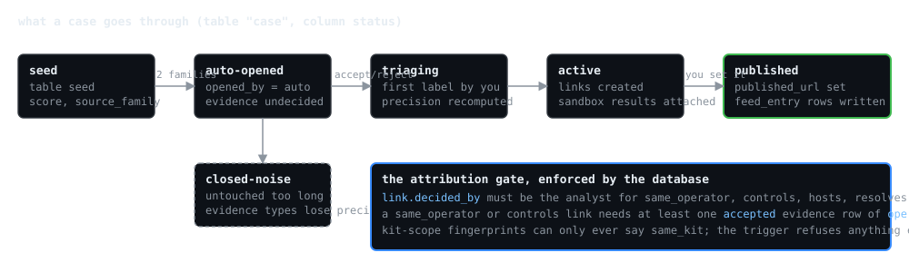

# groundwork

Published findings from my adversary-infrastructure research. Each case here documents a cluster of malicious infrastructure (packages, accounts, domains, hosting) with the evidence that links it, graded by how reliable that kind of evidence has proven to be, and with a record of when each indicator was published relative to the public feeds.

The tooling that produces these findings is not in this repository.

## What is here

* `feed/` a daily IOC feed, one file per day plus a rolling 30-day file, in CSV, STIX 2.1 and MISP JSON. Every row names its case, its evidence types and whether it preceded the public feeds.
* `cases/` one directory per published case, with the write-up, the full evidence table, the indicator list and the timeline.
* `CHANGELOG.md` corrections, retractions and re-gradings, dated. If something here turns out to be wrong, that is where it is said.
* `METHOD.md` how a case is built and graded, what the columns mean, and how to consume the feed.

Long-form write-ups of the larger cases are on Substack and linked from each case page.

## Reading a case

Every evidence row carries two things that let you weigh it yourself. Its scope says what it can prove: operator-scope evidence (a reused commit email, a registrar account, a certificate-generation fingerprint) can link infrastructure to the same operator; kit-scope evidence (a shared resource hash, an install-script shape) can only say two things run the same software; context evidence supports but never links. Its false-positive rate is measured from my own past decisions on that evidence type, so a row from a type that has been wrong one time in three says so.

Indicators are published only from cases I have decided, after sandbox verification where a package or page was involved. Verification bundles are kept privately; their SHA-256 hashes are published with the case so an artefact can be requested and checked.

## Using the feed

The CSV and the MISP event import directly into MISP; the STIX bundle imports into OpenCTI and anything that reads STIX 2.1. Everything is TLP:CLEAR unless a case page says otherwise. Attribution statements are mine and are worded as what the evidence supports, never more.

No licence has been chosen yet for the write-ups; the indicator files may be used freely with a link back.
